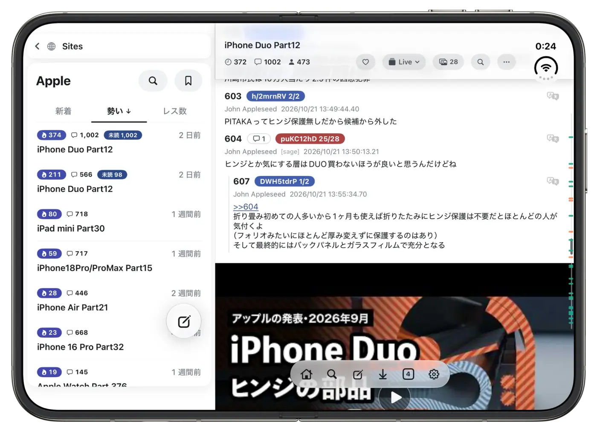
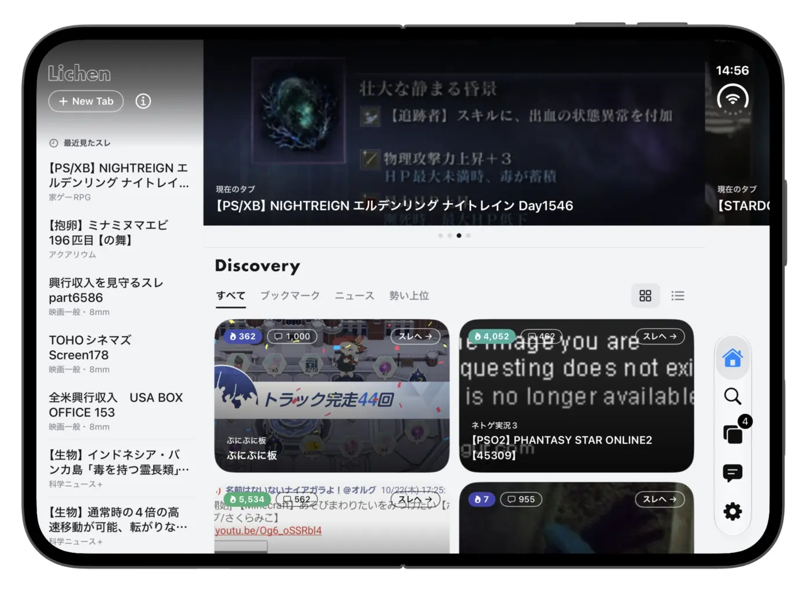

iPhone Duoで5chを読むなら、**Duoの2つの画面に合わせて表示が切り替わる専ブラ（掲示板専用ブラウザ）**を使うのがおすすめです。

閉じた画面ではiPhoneのように片手で、開いた画面ではiPadのように一覧とスレを並べて読めると、Duoの大きな画面を活かせます。

## iPhone Duoで5chを読む方法は？

iPhoneと同じく、Safariなどのブラウザで5chのサイトを開くか、専ブラを使うかの2つです。

ただ、Duoを開いたときの画面は、iPhoneよりずっと広くなります。スマホ向けのページや、iPhoneの画面だけを想定したアプリだと、開いたときに横に間延びしたり、文字やボタンの位置が合わなかったりすることがあります。Duoで快適に読むなら、Duoの画面に対応した専ブラを選びましょう。

ブラウザと専ブラの違いは、で紹介しています。

## LichenはiPhone Duoに対応している？

掲示板専用ブラウザ「Lichen（ライケン）」は、iPhone Duoにネイティブ対応しています。Lichenは、iPhoneとiPadのための、広告のない5ch専ブラです。

Duoを開いたときと閉じたときで、それぞれの画面に合わせて表示を切り替えます。

### 閉じたとき：iPhoneのように

Duoを閉じて外側の画面で使うときは、iPhoneに近い感覚で使えます。スレは画面いっぱいに表示され、片手でさっと読みたいときに向いています。Home・Search・Tabsなどに移るタブバーは、Duoに合わせて画面の右端に縦に並びます。

<figure><figcaption>閉じた外側の画面。右端にタブバーが縦に並びます。</figcaption></figure>

### 開いたとき：iPadのように

Duoを開いて内側の画面で使うときは、iPadのような広い画面向けの表示になります。

- **2カラム表示**：左にスレ一覧、右にスレを並べて、一覧から次々にスレを読める
- **Homeの複数列**：Homeの「Discovery」が広い画面に合わせて並び、盛り上がっているスレを一度にたくさん見渡せる
- **一回り大きい文字**：広い画面に合わせて、文字が少し大きめになる

<figure><figcaption>開いた内側の画面。左にスレ一覧、右にスレの2カラム表示。</figcaption></figure>

Homeは、左に最近見たスレの列、右にDiscoveryのカードが並ぶ、広い画面向けのレイアウトになります。

<figure><figcaption>開いた内側の画面のHome。</figcaption></figure>

### Duoの画面に合わせた、Lichenならではの調整

Duoを開いたときの画面は、iPadとも違う形をしています。画面の端に時計やタブバーが縦に並ぶため、そのままだと文字やボタンが重なってしまうことがあります。

Lichenでは、Duoの画面の形に合わせて、ところどころオリジナルのレイアウトにしています。背景や画像は画面の端まで広げつつ、文字やボタンは時計やタブバーと重ならない位置に置いて、Duoの画面でも読みやすく、操作しやすくしています。

また、画面の大きさは開いたり閉じたりするたびに読み直しているので、Duoを開いた瞬間・閉じた瞬間に、それぞれの画面に合った表示に切り替わります。

## iPadやiPhoneの横向きとの違いは？

Lichenは、iPadやiPhoneを横向きにしたときにも、2カラム表示で読めます。Duoを開いたときは、これに近い広い画面向けの表示に、Duoの画面の形に合わせた調整を加えたものになります。

iPadでの使い方は、やで紹介しています。
